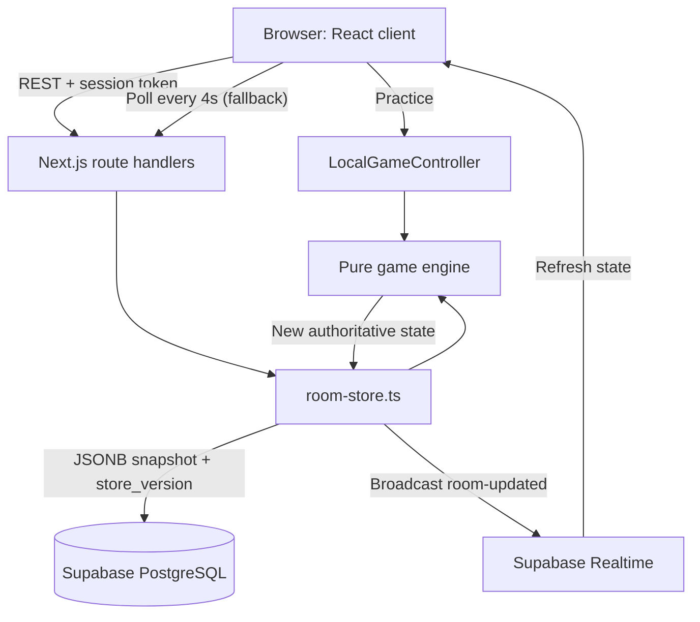

# UNO ARENA

> **Unofficial fan project.** UNO is a registered trademark of Mattel, Inc.
> UNO ARENA is not affiliated with, endorsed by, sponsored by, or approved by
> Mattel. It is a personal, non-commercial project. See
> [License and trademark](#license-and-trademark).

A real-time multiplayer UNO-style card game for the browser. Create a private
room, share a six-character code, and play with 2–10 people — no account,
email, or download required. A complete offline practice mode with bots is
built in as well.

The app ships as a single Next.js application: the React client, the game
engine, the REST API, room persistence, and the realtime fan-out all live in
this repository.

---

## Table of contents

- [Features](#features)
- [Tech stack](#tech-stack)
- [How it works](#how-it-works)
- [UNO rules implemented](#uno-rules-implemented)
- [Project structure](#project-structure)
- [Getting started](#getting-started)
- [Environment variables](#environment-variables)
- [Scripts](#scripts)
- [API reference](#api-reference)
- [Data model](#data-model)
- [Testing](#testing)
- [Deployment](#deployment)
- [Security notes](#security-notes)
- [Documentation](#documentation)
- [License and trademark](#license-and-trademark)

---

## Features

- **Private online rooms** — six-character room codes, invite links, host
  controls, ready checks, and a lobby for 2–10 players.
- **Offline practice** — the entire game runs in the browser against 1–9 bots,
  with no Supabase connection or network requests.
- **Server-authoritative online play** — hands, deck order, turn order, and
  every rule decision are resolved on the server. The browser never receives
  another player's hand.
- **Full 108-card ruleset** — numbers, Skip, Reverse, Draw Two, Wild, and Wild
  Draw Four, including the Wild Draw Four challenge.
- **UNO calls and penalties** — call UNO before your second-to-last card, catch
  a player who forgot, and resolve the catch window when the next player acts.
- **Optional +2 stacking** — a house rule that can be enabled per room.
- **Two scoring modes** — single round, or a cumulative race to a target score.
- **Bots in both modes** — Easy / Medium / Hard difficulty across five
  personalities (Strategist, Aggressor, Defensive, Unpredictable, Balanced).
- **Turn timers and idle handling** — configurable turn clocks, disconnect
  grace periods, and bot takeover for idle online seats.
- **Reconnection** — a hashed reconnect token restores a seat after a refresh
  or a dropped connection.
- **Realtime updates with polling fallback** — Supabase Realtime broadcasts
  prompt a state refresh; a four-second poll keeps the table correct if the
  broadcast is unavailable.
- **Polished table UI** — animated dealing, card flights, directional Reverse
  and Skip effects, an UNO call device, sound effects, responsive seating for
  up to ten players, and a dedicated mobile-landscape layout.
- **Simulation lab** — `/dev/simulation` runs bot-vs-bot matches for engine and
  bot tuning.

---

## Tech stack

| Layer | Choice |
|---|---|
| Framework | [Next.js 16](https://nextjs.org) App Router (React Server Components + client islands) |
| UI | React 19, TypeScript 5, Tailwind CSS 4, hand-written CSS in `src/app/globals.css` |
| Animation | Framer Motion, CSS transitions/keyframes |
| Validation | Zod 4 |
| Database | Supabase PostgreSQL (one JSONB room snapshot per row) |
| Realtime | Supabase Realtime Broadcast, with polling fallback |
| Icons / effects | Lucide React, canvas-confetti |
| Tests | Vitest 4 + fast-check |
| Fonts | Outfit, DM Sans, JetBrains Mono via `next/font` |

No separate backend service, ORM, or Redis instance is required. Online rooms
use Supabase; without Supabase credentials the API falls back to a
process-local in-memory store for development.

---

## How it works

### Two execution modes

**Practice mode** is entirely client-side. `LocalGameController`
(`src/lib/local/local-game.ts`) owns an `AuthoritativeGameState`, runs bot
turns on timers, and notifies React subscribers. It imports the same pure
engine used online, so the rules cannot drift between modes.

**Online mode** is server-authoritative:

1. The browser creates or joins a room through a Next.js route handler.
2. The handler validates the request with Zod and calls `room-store.ts`.
3. `room-store.ts` loads the room, applies game commands through the shared
   engine, persists the new snapshot, and broadcasts `room-updated`.
4. Clients re-fetch public state and their own private hand, then render.
5. A four-second poll acts as a safety net if a broadcast is missed.



### Server authority and consistency

- Every command carries `expectedVersion`. Persistence only succeeds when the
  stored version matches, so two simultaneous moves cannot both apply.
- `commandId` receipts are stored per room, making retries idempotent.
- Opponent hands are removed from `PublicGameState`; a player's hand is only
  returned by the authenticated `GET /api/rooms/:roomId/hand` endpoint.
- Session and reconnect credentials are generated with `crypto.randomBytes`.
  Reconnect tokens are stored as SHA-256 hashes.
- Wild Draw Four legality is evaluated against the player's real hand on the
  server; only the outcome is published.

### Room lifecycle

- Rooms live for 24 hours from creation.
- Finished rooms are retained for 15 minutes, then become eligible for cleanup.
- `POST /api/maintenance/cleanup` deletes expired lobby/finished rooms and never
  deletes an active `IN_GAME` room. It requires the `x-cleanup-secret` header.

### Storage modes

`src/lib/supabase/admin.ts` returns a service-role client only when both
`NEXT_PUBLIC_SUPABASE_URL` and `SUPABASE_SERVICE_ROLE_KEY` are configured.
Otherwise `room-store.ts` uses a process-wide `Map`. Memory mode is convenient
for local development but is not durable and is not shared between serverless
instances — configure Supabase for any real deployment.

### Realtime

The server posts a small `room-updated` event to the Supabase Realtime
`uno:room:{roomId}` channel. The event contains only the room ID; clients
re-fetch state through the authenticated REST endpoints. Realtime is treated
as an optimization, not a source of truth.

---

## UNO rules implemented

- Standard 108-card deck: 19 number cards per color (one 0, two each of 1–9),
  two Skip / Reverse / Draw Two per color, four Wild, four Wild Draw Four.
- Seven cards per player; the top card starts the discard pile.
- Skip, Reverse, Draw Two, Wild, and Wild Draw Four behavior.
- Reverse acts as Skip in a two-player game.
- Wild Draw Four challenge: legal only when the player holds no card matching
  the previous active color; penalties are applied server-side.
- UNO declaration window and missed-UNO catch window.
- Voluntary draw: draw one card, then play that card or pass. Drawing multiple
  times in one turn is not allowed.
- Single-round and cumulative scoring; standard card point values
  (numbers face value, actions 20, wilds 50).
- Optional Draw Two stacking.
- First-card edge cases (Wild Draw Four is reshuffled; Wild starts with a color
  choice; Draw Two and Skip apply to the first player).

For the full rule rationale and edge cases, see
[`docs/GAME_RULES.md`](docs/GAME_RULES.md) and
[`docs/RULE_DECISIONS.md`](docs/RULE_DECISIONS.md).

---

## Project structure

```text
.
├─ src/
│  ├─ app/
│  │  ├─ api/                 # Route handlers (rooms, health, cleanup)
│  │  ├─ dev/simulation/      # Bot-vs-bot simulation lab
│  │  ├─ globals.css          # Design system and all table/card styles
│  │  ├─ layout.tsx           # Fonts, metadata, viewport
│  │  └─ page.tsx             # Home / lobby / game view controller
│  ├─ components/
│  │  ├─ card/                # Card renderer
│  │  ├─ controls/            # UNO call device
│  │  ├─ home/                # Landing page and room forms
│  │  ├─ lobby/               # Room lobby
│  │  ├─ modals/              # Wild color, challenge, round summary
│  │  ├─ table/               # Table, seats, hands, effects, header
│  │  └─ ui/                  # Shared primitives (Button, Badge, Brand, ...)
│  ├─ lib/
│  │  ├─ game-engine/         # Pure rules engine, cards, scoring, bots
│  │  ├─ local/               # Browser-only practice controller
│  │  ├─ realtime/            # Supabase broadcast client/server
│  │  ├─ server/              # Room persistence and HTTP helpers
│  │  ├─ simulation/          # Batch bot simulation
│  │  ├─ sound/               # Sound effect manager
│  │  └─ supabase/            # Server-only Supabase admin client
│  └─ types/                  # Shared domain and public-state types
├─ supabase/migrations/       # PostgreSQL schema and cleanup function
├─ docs/                      # Rules, architecture, bots, operations, audits
├─ public/                    # Static assets
└─ .env.example               # Environment variable template
```

---

## Getting started

### Prerequisites

- Node.js **20.9 or newer**
- npm 10+ (a `package-lock.json` is committed)
- Optional: a Supabase project for durable online rooms

### 1. Install

```bash
git clone https://github.com/XHLEIK/UNO-ARENA.git
cd UNO-ARENA
npm install
```

### 2. Configure environment variables

```bash
cp .env.example .env.local
```

Then fill in your Supabase values. On Windows PowerShell:

```powershell
Copy-Item .env.example .env.local
```

If you leave Supabase unset, the app still runs: online rooms use the
in-memory store and practice mode works normally. Data disappears when the
process restarts, and separate serverless instances will not share rooms.

### 3. Create the database table (recommended)

Run [`supabase/migrations/0001_rooms.sql`](supabase/migrations/0001_rooms.sql)
in the Supabase SQL editor, or with the Supabase CLI:

```bash
npx supabase link --project-ref <your-project-ref>
npx supabase db push
```

The migration creates `public.rooms`, enables row-level security with no
policies, and grants access only to the `service_role`. Browser clients never
query the table directly.

### 4. Run

```bash
npm run dev
```

Open <http://localhost:3000>.

### 5. Verify

```bash
npm run test
npm run build
```

---

## Environment variables

| Variable | Required | Exposure | Purpose |
|---|---|---|---|
| `NEXT_PUBLIC_SUPABASE_URL` | Online mode | Public | Supabase project URL |
| `NEXT_PUBLIC_SUPABASE_PUBLISHABLE_KEY` | Online mode | Public | Supabase anon/publishable key |
| `SUPABASE_SERVICE_ROLE_KEY` | Online mode | **Server only** | Durable room storage and Realtime broadcast |
| `CLEANUP_SECRET` | Cleanup endpoint | **Server only** | Authenticates `POST /api/maintenance/cleanup` |
| `SUPABASE_ACCESSTOKEN` | CLI only | **Local only** | Supabase CLI authentication; unused at runtime |

`SUPABASE_SECRET_KEY` is also accepted as an alias for the service-role key by
the server code. Never place a service-role key in a `NEXT_PUBLIC_*` variable
or import the admin client from a client component.

---

## Scripts

| Command | Description |
|---|---|
| `npm run dev` | Start the Next.js development server |
| `npm run build` | Production build (also runs TypeScript checks) |
| `npm start` | Serve the production build |
| `npm test` | Run the Vitest suite once |
| `npm run lint` | Run ESLint |

---

## API reference

All endpoints are Next.js route handlers under `src/app/api`. Request bodies
are validated with Zod. Online mutations require a `playerId` and the
`sessionToken` returned when the room was created or joined.

| Method | Endpoint | Purpose |
|---|---|---|
| `POST` | `/api/rooms` | Create a room; returns room, player, session token, reconnect token |
| `POST` | `/api/rooms/join` | Join by room code and nickname |
| `GET` | `/api/rooms/:roomId` | Public room details; private state when viewer credentials are supplied |
| `POST` | `/api/rooms/:roomId/ready` | Toggle ready state |
| `POST` | `/api/rooms/:roomId/start` | Host starts the game |
| `POST` | `/api/rooms/:roomId/actions` | Submit a game command |
| `GET` | `/api/rooms/:roomId/hand` | Fetch the caller's private hand |
| `POST` | `/api/rooms/:roomId/reconnect` | Restore a seat with a reconnect token |
| `POST` | `/api/rooms/:roomId/leave` | Leave the room |
| `GET` | `/api/health` | Health, storage mode, and realtime configuration |
| `POST` | `/api/maintenance/cleanup` | Delete eligible expired rooms (secret header required) |

Supported command types:

`PLAY_CARD`, `DRAW_CARD`, `PASS_TURN`, `CALL_UNO`, `CATCH_MISSED_UNO`,
`SELECT_COLOR`, `CHALLENGE_WILD_DRAW_FOUR`, `ACCEPT_WILD_DRAW_FOUR`.

See [`docs/API_REFERENCE.md`](docs/API_REFERENCE.md) for payloads and status
codes.

---

## Data model

Each room is a single `jsonb` document in `public.rooms`:

| Column | Type | Notes |
|---|---|---|
| `id` | `uuid` | Primary key |
| `room_code` | `text` | Unique six-character join code |
| `status` | `text` | `LOBBY`, `IN_GAME`, or `FINISHED` |
| `store_version` | `bigint` | Optimistic-concurrency guard |
| `record` | `jsonb` | Room, players, game state, command receipts |
| `created_at` / `updated_at` | `timestamptz` | Timestamps |
| `expires_at` | `timestamptz` | Cleanup eligibility |

The trade-off is deliberate: one row per room keeps every command atomic and
avoids multi-table coordination. It is a good fit for small private rooms, not
for analytics or cross-room queries.

---

## Testing

```bash
npm test
```

The suite covers the pure engine, UNO call/catch semantics, Wild Draw Four
challenges, scoring, card conservation, and local bot games. Property-based
tests use `fast-check` to exercise randomized state transitions.

`npm run lint` currently reports pre-existing style/type-debt issues; the build
and test suite are the release gates.

---

## Deployment

The simplest deployment is **Vercel + Supabase**:

1. Create a Supabase project and run the migration.
2. Import the repository into Vercel.
3. Add `NEXT_PUBLIC_SUPABASE_URL`, `NEXT_PUBLIC_SUPABASE_PUBLISHABLE_KEY`,
   `SUPABASE_SERVICE_ROLE_KEY`, and `CLEANUP_SECRET` to the project.
4. Deploy.
5. Schedule a daily `POST /api/maintenance/cleanup` request with the
   `x-cleanup-secret` header, or invoke the cleanup from your own scheduler.

Any Node host that can run Next.js works as well. If you self-host, make sure
all instances share the Supabase database — in-memory mode is per process.

See [`docs/DEPLOYMENT.md`](docs/DEPLOYMENT.md) for the full checklist.

---

## Security notes

- The Supabase service-role key is only read by server modules. Do not import
  `src/lib/supabase/admin.ts` into client components.
- `public.rooms` has RLS enabled with no policies; only the service role can
  read or write it.
- Every online mutation validates the player's session token before applying a
  command.
- Reconnect tokens are stored hashed, not in plain text.
- Command retries are idempotent through stored `commandId` receipts.
- No accounts, emails, or passwords are collected. Nicknames are the only
  user-supplied identity.
- The repository intentionally ships without a rate limiter. If you expose a
  public deployment, put a WAF or platform rate limit in front of the room
  endpoints, especially joins and room creation.

To report a vulnerability, see [`SECURITY.md`](SECURITY.md). Please do not open
a public issue for a security problem.

---

## Documentation

`docs/` contains the rules, engine design, bot behavior, operations notes, and
development audits. The most useful entry points are:

- [`docs/GAME_RULES.md`](docs/GAME_RULES.md) — complete rules and inventory
- [`docs/GAME_ENGINE.md`](docs/GAME_ENGINE.md) — state machine and invariants
- [`docs/ARCHITECTURE.md`](docs/ARCHITECTURE.md) — shipped system architecture
- [`docs/API_REFERENCE.md`](docs/API_REFERENCE.md) — request/response reference
- [`docs/BOT_INTELLIGENCE.md`](docs/BOT_INTELLIGENCE.md) — bot scoring and behavior
- [`docs/DEPLOYMENT.md`](docs/DEPLOYMENT.md) — deployment and operations
- [`docs/PROJECT_PROGRESS_INDEX.md`](docs/PROJECT_PROGRESS_INDEX.md) — implementation snapshot

Some documents were written during the design phase and describe a planned
Fastify/Prisma service split. The shipped implementation is the single Next.js
route-handler architecture described in this README. The README and
`docs/ARCHITECTURE.md` are the authoritative descriptions of what runs today.

---

## License and trademark

### Code license

Original source code in this repository is licensed under the
**PolyForm Noncommercial License 1.0.0**. See [`LICENSE`](LICENSE).

In short: you may use, modify, and share the code for personal, hobby,
educational, research, and other non-commercial purposes. Commercial use is not
permitted. The software is provided without warranty.

This is a source-available project, not an OSI-approved open-source project.

### Trademark and fan-project notice

**UNO® is a registered trademark of Mattel, Inc.** All rights in the UNO name,
logo, and brand belong to Mattel.

UNO ARENA is an **unofficial, non-commercial fan project**. It is not
affiliated with, endorsed by, sponsored by, or approved by Mattel. No Mattel
logos, card artwork, packaging, or other proprietary assets are included in
this repository. Card faces and table art are original CSS/SVG renderings
created for this project; the name "UNO" is used only to describe the game
rules being implemented.

This project is not monetized. It does not sell cards, subscriptions, ads, or
licenses. If a rights holder requests that the project be taken down or
renamed, the maintainer will comply.

### Third-party software

The project depends on open-source packages listed in `package.json` and
`package-lock.json`; each retains its own license. Fonts are loaded through
`next/font` (Outfit, DM Sans, JetBrains Mono, SIL Open Font License). See
[`NOTICE`](NOTICE) for the attribution summary.

---

## Acknowledgements

Game design inspiration: the original UNO card game by Merle Robbins and
Mattel, Inc. Built with Next.js, React, Supabase, Tailwind CSS, Framer Motion,
Zod, Lucide, and Vitest. Thanks to the open-source maintainers behind those
projects.
