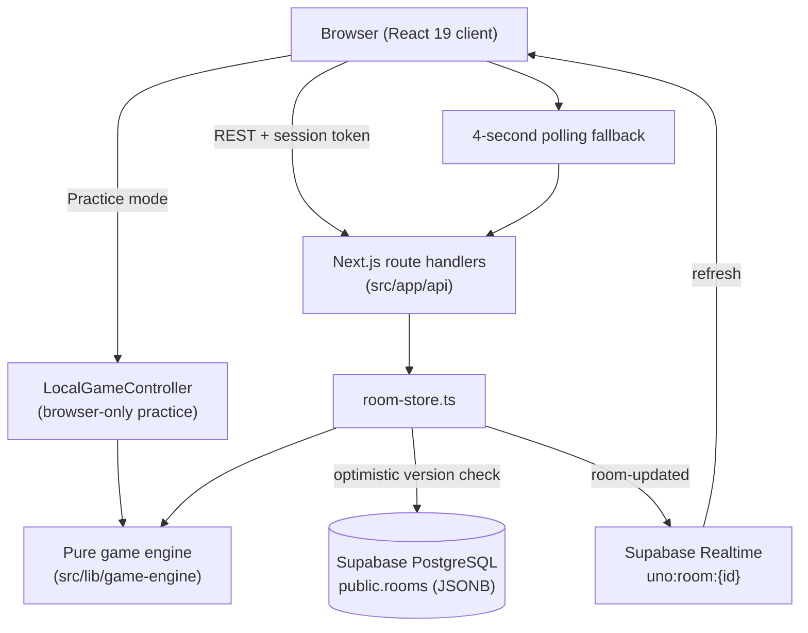

# UNO ARENA — System Architecture

This document describes the **shipped** architecture. Some other documents in
`docs/` were written during the design phase and describe a planned
Fastify/Prisma service split; that split was not implemented. The application
is a single Next.js project.

## 1. High-level topology

There is no separate API server, ORM, message queue, or Redis instance. Next.js
route handlers are the backend, and Supabase provides durable storage and
best-effort realtime fan-out.

## 2. Responsibilities

### Presentation (`src/app`, `src/components`)

`src/app/page.tsx` owns the home → lobby → game view state, online session
persistence, polling, Realtime subscription, and landscape orientation lock.
Table components are presentational and receive `PublicGameState` plus the
viewer's `PrivatePlayerState`.

### Pure game engine (`src/lib/game-engine`)

- `engine.ts` — deterministic state machine for every command
- `cards.ts` — 108-card deck construction, shuffle, and scoring values
- `scoring.ts` — round and cumulative scoring
- `validation.ts` — shared validation helpers
- `bot.ts` — bot decisions, personalities, and difficulty weights

The engine has no network, database, timer, or React dependency. Every
transition returns a new state and throws a typed engine error for illegal
moves. Invariants are asserted after transitions: 108 unique cards, valid turn
bounds, and a non-empty discard pile.

### Local practice (`src/lib/local/local-game.ts`)

`LocalGameController` wraps the engine in a browser session. It owns bot timers,
notifies subscribers, and exposes the same public/private projections used
online. No Supabase or network call is made.

### Server layer (`src/lib/server/room-store.ts`)

The room store is the authority for online play:

- Creates and joins rooms, issues session and reconnect tokens.
- Loads the latest room snapshot.
- Authenticates the caller and checks that it is their turn.
- Applies one command through the engine.
- Persists with an optimistic `store_version` check.
- Records `commandId` receipts for idempotent retries.
- Runs bot turns and turn-timer/idle maintenance.
- Broadcasts a `room-updated` signal after a successful commit.

Commands are serialized per room through the database version check. A failed
version comparison rejects the write rather than overwriting another player's
move.

### Persistence (`supabase/migrations/0001_rooms.sql`)

One row per room. `record` holds the room and authoritative game state;
`store_version` guards writes; `expires_at` supports cleanup. RLS is enabled
with no policies, so only the `service_role` can access the table.

When Supabase is not configured, the store falls back to a process-wide
`Map`. This keeps local development usable but is not durable and is not shared
between serverless instances.

### Realtime (`src/lib/realtime`)

The server posts `{ roomId }` to the Supabase Realtime Broadcast channel
`uno:room:{roomId}` with the `room-updated` event. Clients then re-fetch state;
the broadcast never carries hands or authoritative payloads. A four-second poll
covers missed broadcasts, so realtime is an optimization rather than a
correctness dependency.

## 3. Trust boundaries

| Boundary | Rule |
|---|---|
| Browser → API | Every mutation is Zod-validated; player identity is proven with `playerId` + `sessionToken`. |
| API → game engine | Only the server calls mutating engine functions for online rooms. |
| API → database | Service-role client only; never imported into a client component. |
| Public state | Opponent hands and draw-pile order are removed before serialization. |
| Private hand | Returned only by the authenticated hand endpoint. |
| Reconnect | 256-bit token, stored as a SHA-256 hash. |
| Cleanup | Requires `x-cleanup-secret`; active games are never deleted. |

## 4. Room lifecycle

1. `POST /api/rooms` creates a `LOBBY` room and its host.
2. Players join by code and mark ready.
3. The host starts the game; the engine deals and sets the first turn.
4. Commands advance the game until `ROUND_FINISHED` or `MATCH_FINISHED`.
5. Rooms expire after 24 hours; finished rooms are retained for 15 minutes.
6. `POST /api/maintenance/cleanup` removes eligible expired rooms.

## 5. Deliberate trade-offs

- **JSONB snapshot instead of normalized tables** — simple atomic commands and
  easy versioning; poor fit for analytics or very large rooms.
- **Polling fallback instead of guaranteed delivery** — simple and robust; up
  to four seconds of staleness if Realtime fails.
- **No accounts** — instant play and minimal personal data; identity is a
  bearer session token stored in the browser.
- **Single Next.js app instead of service split** — one deploy target and one
  language; the engine remains portable if the backend is extracted later.
