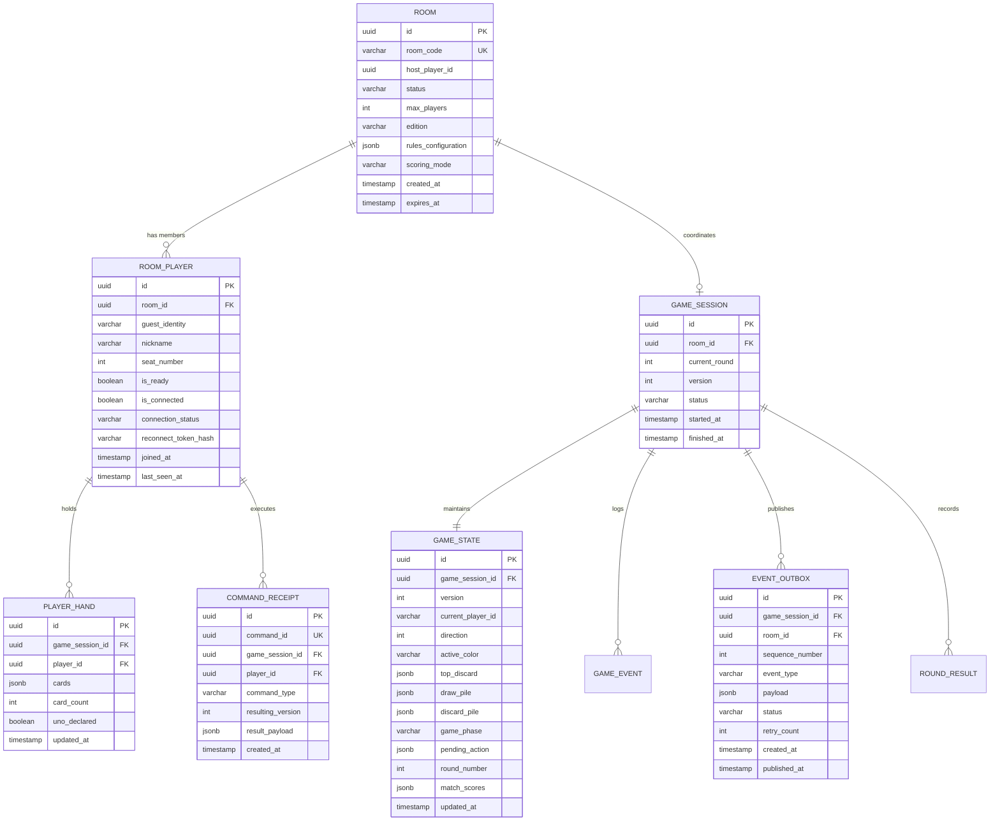

# UNO ARENA — Database Schema & Data Dictionary

## 1. Relational Schema Design

UNO ARENA utilizes PostgreSQL hosted on Supabase as the single authoritative source of truth.

---

## 2. Table Specifications & Indexes

### 2.1 `rooms`
- `id` (UUID, Primary Key, default `gen_random_uuid()`)
- `room_code` (VARCHAR(6), Unique, Indexed): Cryptographically random 6-character alphanumeric code for inviting players.
- `host_player_id` (UUID): Reference to the creator of the room.
- `status` (VARCHAR(32)): `LOBBY`, `IN_GAME`, `FINISHED`, `ABANDONED`.
- `max_players` (INT, Default 10): 2 to 10 players.
- `rules_configuration` (JSONB): Stacking toggle, turn timer length, bot grace period.
- `scoring_mode` (VARCHAR(32)): `SINGLE_ROUND` or `CUMULATIVE`.
- `target_score` (INT, Default 500).

### 2.2 `room_players`
- `id` (UUID, Primary Key)
- `room_id` (UUID, Foreign Key $\rightarrow$ `rooms.id` ON DELETE CASCADE)
- `guest_identity` (VARCHAR(64)): Anonymous identity generated on first visit.
- `nickname` (VARCHAR(32)): Display name chosen by player.
- `seat_number` (INT): Seat index from 0 to 9. Unique constraint on `(room_id, seat_number)`.
- `is_ready` (BOOLEAN): Lobby ready check state.
- `is_connected` (BOOLEAN): Connection flag updated by presence / disconnect handlers.
- `reconnect_token_hash` (VARCHAR(128)): Argon2/SHA-256 hash of secret reconnection token issued to player.

### 2.3 `game_state`
- `game_session_id` (UUID, Foreign Key $\rightarrow$ `game_sessions.id`)
- `version` (INT, Not Null): Monotonically increasing version counter for optimistic locking.
- `current_player_id` (UUID): Whose turn it is.
- `direction` (INT): `1` (Clockwise) or `-1` (Counter-Clockwise).
- `active_color` (VARCHAR(16)): `RED`, `BLUE`, `GREEN`, `YELLOW`.
- `top_discard` (JSONB): Complete card object of current active discard.
- `draw_pile` (JSONB): Array of card objects currently remaining in Draw Pile.
- `discard_pile` (JSONB): Array of card objects currently in Discard Pile.
- `game_phase` (VARCHAR(32)): `ACTIVE_TURN`, `DRAW_DECISION`, `WILD_COLOR_SELECTION`, `WILD_FOUR_CHALLENGE`, `ROUND_FINISHED`, etc.
- `pending_action` (JSONB): Stacking accumulation, challenge metadata.

### 2.4 `player_hands`
- `id` (UUID, Primary Key)
- `game_session_id` (UUID)
- `player_id` (UUID)
- `cards` (JSONB): Array of private card objects currently held by this player.
- `card_count` (INT): Cached count for rapid public projection without deserializing private cards.
- `uno_declared` (BOOLEAN): Flag set when player calls UNO with 1 card.
- Unique constraint on `(game_session_id, player_id)`.

### 2.5 `event_outbox`
- Ensures at-least-once, ordered delivery to Supabase Realtime broadcast channels.
- `sequence_number` (INT): Monotonic sequence number per room.
- `status` (VARCHAR(16)): `PENDING`, `PUBLISHED`, `FAILED`.
- Index on `(status, created_at)`.
