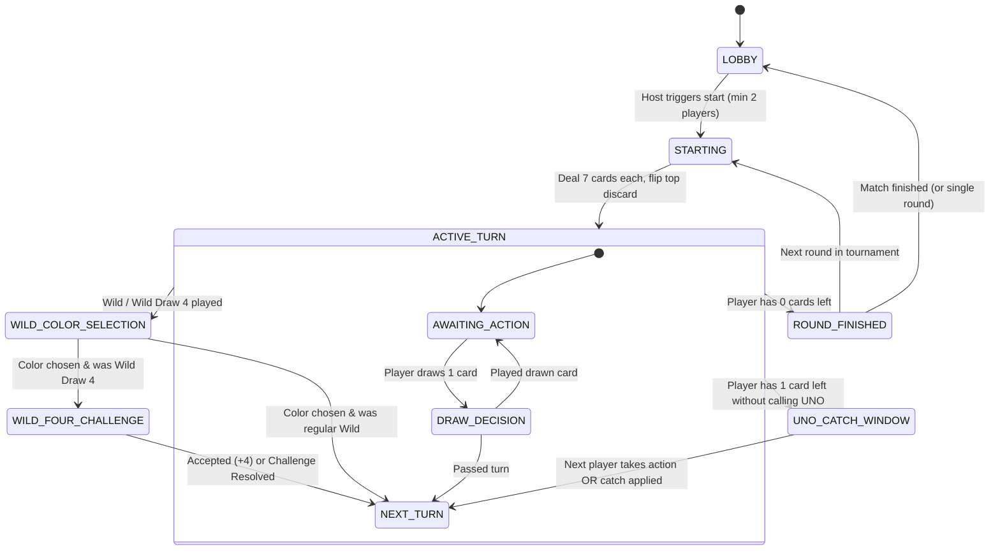

# UNO ARENA — Game Engine Architecture & State Machine

## 1. Engine Philosophy
The `@uno-arena/game-engine` is a **pure, side-effect-free, deterministic TypeScript state machine**.
- Zero database imports.
- Zero network or timer imports.
- Every state transition is an immutable function:
  $$f(\text{State}, \text{Action}) \rightarrow \text{Result}<\text{NewState}, \text{EngineError}>$$

---

## 2. State Machine Phases

---

## 3. Invariant Verifications

After every transition, the engine automatically asserts the following mathematical invariants:
1. **Card Conservation**: `drawPile.length + discardPile.length + sum(playerHands.length) === 108`.
2. **Card Uniqueness**: Set of all card IDs has size exactly 108.
3. **Turn Bounds**: Current player index is always within valid active player bounds.
4. **Non-Empty Discard Pile**: Discard pile has at least 1 card (the active top discard).
